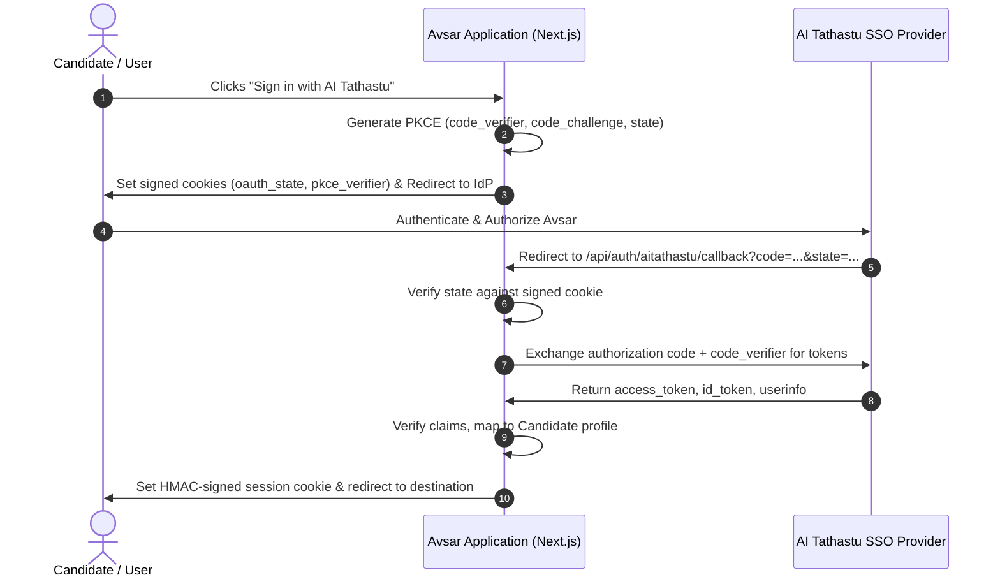

# AI Tathastu Single Sign-On (SSO) Integration

## Overview

Avsar uses **AI Tathastu** as its authoritative Identity Provider (IdP) for candidate and administrative authentication. This document details the OAuth 2.0 PKCE protocol implementation, claims verification, session lifecycle management, and diagnostic endpoints.

---

## Architecture & Flow



---

## 1. OAuth 2.0 with PKCE (Proof Key for Code Exchange)

To prevent authorization code interception and CSRF attacks, Avsar enforces RFC 7636 PKCE:
- **Code Verifier**: A cryptographically random 43–128 character URL-safe string generated using `crypto.randomBytes(32).toString('base64url')`.
- **Code Challenge**: SHA-256 hash of the code verifier: `BASE64URL(SHA256(code_verifier))`.
- **Challenge Method**: `S256`.
- **State Token**: A secure random UUID cryptographically bound to the session via an HMAC-SHA256 signature in a temporary HTTP-only cookie.

---

## 2. Token Exchange & Claims Verification

Upon receiving the authorization code at `/api/auth/aitathastu/callback`:
1. **State Validation**: `req.query.state` must match the stored state cookie.
2. **Timing-Safe Comparison**: All cryptographic token comparisons use `crypto.timingSafeEqual` to thwart timing attacks.
3. **PKCE Verification**: The IdP verifies `code_verifier` against the initial `code_challenge`.
4. **Token Decoding & Claims Audit**:
   - `sub`: Unique identity subject identifier from AI Tathastu.
   - `email`: Verified candidate email address.
   - `name`: Candidate's full name.
   - `role`: Role assignment (`candidate` or `admin`).
   - `aud`: Must match `AI_TATHASTU_CLIENT_ID`.
   - `iss`: Must match `AI_TATHASTU_ISSUER_URL`.

---

## 3. Session Security & Cookie Handling

Avsar uses stateless, tamper-proof session cookies:
- **Cookie Name**: `avsar_session`
- **Security Flags**:
  - `HttpOnly`: Prevents client-side JavaScript access (XSS mitigation).
  - `Secure`: Transmitted only over HTTPS in production (`NODE_ENV === 'production'`).
  - `SameSite=Lax`: Balances top-level navigation usability with CSRF protection.
  - `Path=/`: Valid across all application routes.
- **HMAC-SHA256 Signature**: The session payload is serialized into JSON and signed with `SESSION_SECRET`:
  ```
  session_cookie = base64(payload) + "." + hmac_sha256(base64(payload), secret)
  ```
- **Session Duration**: Default 7 days (604,800 seconds).

---

## 4. Local Development vs. Production Mode

Avsar provides seamless developer experience while maintaining strict production safety:

| Feature | Development Mode (`NODE_ENV=development`) | Production Mode (`NODE_ENV=production`) |
| :--- | :--- | :--- |
| **Provider Fallback** | Mock IdP simulator available for offline dev | Strict remote AI Tathastu OAuth 2.0 endpoints required |
| **HTTPS Cookies** | `Secure: false` (allows `http://localhost:3000`) | `Secure: true` (mandatory HTTPS) |
| **Strict Redirects** | Allows `localhost` and `127.0.0.1` | Must match verified domain whitelist |
| **Credentials** | Development defaults tolerated with warning | Missing `CLIENT_SECRET` halts startup with error |

---

## 5. Diagnostic & Health Endpoints

- **`GET /api/auth/diagnostics`**: Returns current SSO configuration status, IdP connectivity, and configured scopes without exposing secrets.
- **`GET /api/auth/session`**: Returns currently authenticated user context, roles, and session expiry.
- **`POST /api/auth/logout`**: Invalidates session cookie and triggers single sign-out redirect if supported.
