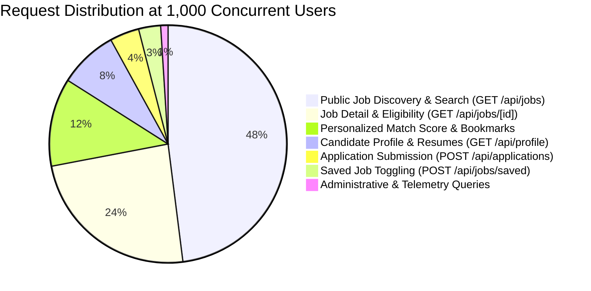
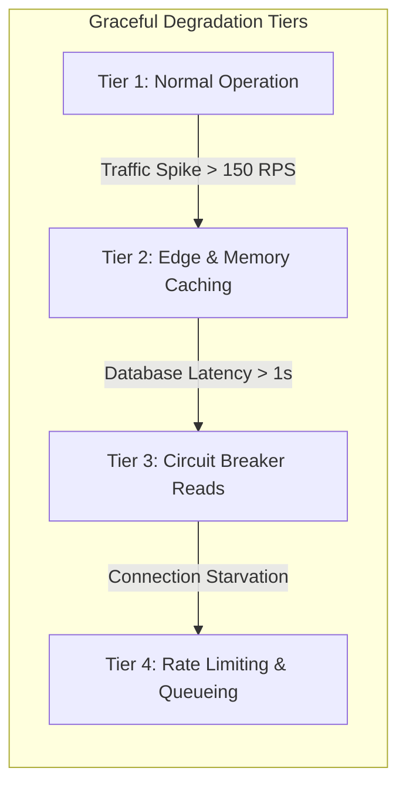

# Avsar by AI Tathastu — Enterprise Capacity & Concurrency Model

This document establishes the official engineering capacity model, workload distribution, and resource sizing for **Avsar by AI Tathastu** to support **5,000–8,000 registered users** with **1,000 concurrent active users**.

---

## 1. Concurrency Definitions & Traffic Sizing

| Metric | Target Specification | Architectural Rationale |
|---|---|---|
| **Registered User Base** | 5,000 – 8,000 candidates | Total student and jobseeker pool registered via AI Tathastu SSO |
| **Daily Active Users (DAU)** | 2,500 – 3,500 users/day | Typically 30% – 50% of registered base active during campus drives |
| **Peak Concurrent Users (CCU)** | **1,000 active virtual users** | Simultaneous active sessions during peak placement windows (10:00–14:00 IST) |
| **Average User Think Time** | 8 – 12 seconds | Time spent reading job descriptions, reviewing eligibility, and completing forms |
| **Calculated Request Rate (RPS)** | **100 – 125 req/sec (sustained)** | $\text{RPS} = \frac{\text{CCU}}{\text{Think Time}} = \frac{1000}{8\text{ to }10\text{s}}$ |
| **Peak Burst Rate (RPS)** | **200 – 250 req/sec (burst)** | Surge traffic during instant job alerts or application deadline hours |
| **Daily Request Volume** | 3.5M – 5.0M requests/day | Sustained daily traffic across static assets and API invocations |

---

## 2. Workload Mix & Read/Write Distribution

Recruitment platforms exhibit heavy read-skewed traffic profiles inspired by LinkedIn, Naukri.com, and Disney+ Hotstar career portals.

### Read vs. Write Ratio
- **Read Requests (92% of total traffic):**
  - Public job search and filter queries: ~50–60 RPS
  - Job detail views & eligibility breakdowns: ~25–30 RPS
  - Candidate profile reads & resume metadata: ~10–15 RPS
  - Health checks & system probes: ~2–5 RPS
- **Write Requests (8% of total traffic):**
  - Application submissions: ~4–8 RPS
  - Saved job bookmarks: ~3–5 RPS
  - Resume uploads: ~0.5–2 RPS
  - Audit logging: ~10–20 background events/sec

---

## 3. Infrastructure Resource Calculations

### 3.1 Next.js on Vercel Serverless Compute
- **Execution Model:** Stateless ephemeral serverless containers (AWS Lambda runtime underneath Vercel).
- **Concurrency Required:** At 100–125 RPS with an average response time of 150ms:
  $$\text{Concurrent Lambda Executions} = \text{RPS} \times \text{Duration} = 125 \times 0.15\text{s} \approx 19\text{ concurrent instances}$$
- **Peak Burst Concurrency (250 RPS at 250ms):**
  $$\text{Burst Executions} = 250 \times 0.25\text{s} \approx 63\text{ concurrent instances}$$
- **Vercel Plan Sizing:** Vercel Pro/Enterprise provides 1,000+ default function concurrency, easily accommodating 63–100 active functions without queueing.

### 3.2 Neon Serverless PostgreSQL & Connection Pooling
- **Compute Sizing:** Neon 1.0 – 2.0 Compute Units (CU) provides 4GB – 8GB RAM and 1 – 2 vCPUs, capable of handling 500+ active TPS on indexed queries.
- **Connection Management:**
  - Direct PostgreSQL connections are strictly prohibited from serverless lambdas.
  - All application instances connect through Neon's **PgBouncer Connection Pooler** (`-pooler.neon.tech`).
  - Max pool size per Lambda container: `DB_POOL_MAX=5` to `10`.
  - Pooled connections reuse PostgreSQL compute sessions across thousands of rapid lambda invocations.
- **Query Budget:**
  - 95th percentile query execution time: $\le 15\text{ms}$ on indexed queries.
  - Statement timeout: $3,000\text{ms}$ hard cap to prevent thread starvation.

### 3.3 Private Object Storage (AWS S3 / Cloudflare R2)
- **Document Payload:** 5,000 candidates $\times$ average 1.5 resumes $\times$ 1.2MB = **9GB storage volume**.
- **Bandwidth:** At peak 1,000 users with resume downloads & uploads: ~25–50 MB/hour egress.
- **Access Pattern:** Short-lived presigned URLs (300s TTL) offload binary streaming from serverless memory.

---

## 4. Service Level Objectives (SLOs)

| User Operation | Target p50 Latency | Target p95 Latency | Target p99 Latency | Max Error Rate |
|---|---|---|---|---|
| **Public Job Search (`/api/jobs`)** | < 120 ms | < 350 ms | < 600 ms | < 0.2% |
| **Job Details (`/api/jobs/[id]`)** | < 80 ms | < 250 ms | < 450 ms | < 0.1% |
| **Profile Read (`/api/profile`)** | < 100 ms | < 300 ms | < 500 ms | < 0.2% |
| **Application Submission (`POST /api/applications`)** | < 200 ms | < 600 ms | < 1,000 ms | < 0.5% |
| **Saved Job Toggle (`POST /api/jobs/saved`)** | < 90 ms | < 250 ms | < 450 ms | < 0.2% |
| **Resume Upload (`POST /api/resumes`)** | < 400 ms | < 1,200 ms | < 2,000 ms | < 0.5% |
| **Health Check (`/api/health`)** | < 40 ms | < 100 ms | < 200 ms | 0.0% |

---

## 5. Scaling Bottlenecks & Degradation Strategies

1. **Database Connection Saturation:** Mitigated by PgBouncer transaction-mode pooling, idle connection harvesting (30s), and client-side statement timeouts.
2. **Deep Pagination Scans:** Mitigated by keyset / cursor pagination (`limit` + `posted_at < cursor`), replacing expensive `OFFSET` scanning over thousands of jobs.
3. **Repeated Job Listings Invocations:** Mitigated by multi-tier LRU in-memory and edge caching with 60-second TTL.
4. **Sudden Burst Traffic:** Mitigated by token-bucket sliding-window rate limiters distinguishing anonymous visitors from authenticated candidates.
