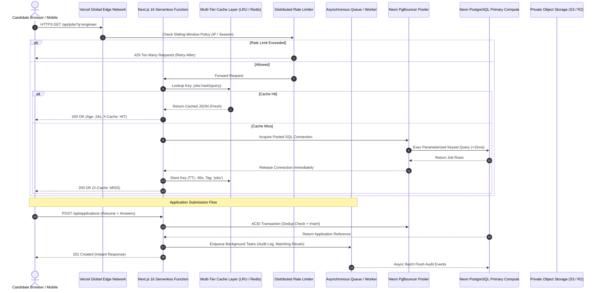

# Avsar by AI Tathastu — High Concurrency Architecture Specification

This specification establishes the production architectural patterns powering **Avsar by AI Tathastu** under high concurrency (**1,000 active concurrent users**, **100–250 requests/second**).

---

## 1. End-to-End Enterprise Request Pipeline

---

## 2. Core Architectural Pillars

### Pillar 1: Stateless Serverless Execution
- **Stateless Function Instances:** Vercel functions maintain zero persistent local state. Any instance can service any request from any candidate.
- **Connection Reuse:** PostgreSQL connection pools are managed at the container level through PgBouncer, eliminating connection storms when scaling from 5 to 60 concurrent lambdas.
- **Circuit Breakers:** High-cost services (PostgreSQL queries, S3 presigning) are protected by a stateful circuit breaker (`CLOSED`, `OPEN`, `HALF_OPEN`) to prevent cascading lambda timeouts.

### Pillar 2: Read-Through Multi-Tier Caching
- **Tier 1 (In-Memory LRU Cache):** High-frequency read queries (e.g. popular job searches, landing page data) are cached in an LRU memory cache with deterministic SHA-256 keys.
- **Tier 2 (Distributed Cache Adapter):** Standard provider interface supporting Redis/Upstash for multi-container cache synchronization.
- **Stampede Prevention (Singleflight):** Concurrent identical requests for an expired cache key share a single in-flight database query, preventing thundering herds.
- **Multi-Tenant Security Invariant:**
  > **Invariant:** Private candidate data (profile, resumes, submitted applications, bookmarks) MUST NEVER share a global cache key. User-specific keys are strictly scoped by `cand_{id}:*` and protected by authenticated session verification.

### Pillar 3: Database Query Optimization & Keyset Pagination
- **Cursor / Keyset Pagination:** Deep offset pagination (`OFFSET 500 LIMIT 20`) causes the database to read and discard hundreds of rows. Keyset pagination using `(posted_at, id) < (cursor_timestamp, cursor_id)` leverages B-tree composite indexes for $O(\log N)$ retrieval regardless of page depth.
- **Covering Composite Indexes:** High-cardinality query patterns (`status = 'Active' ORDER BY posted_at DESC`) are fully covered by multi-column indexes.
- **Short-Lived Transactions:** Transactions are scoped strictly to mutating operations (`submitApplication`, `toggleSavedJob`) and execute within `< 25ms`.

### Pillar 4: Non-Blocking Asynchronous Processing
- **Decoupled Request Paths:** Operations that do not affect the immediate HTTP response (audit logging, analytics counters, match score recalculation) are offloaded to an asynchronous in-memory / background queue.
- **Idempotent Workers:** Every background task carries an idempotency key (`action:candidateId:resourceId`) to guarantee safe retries under transient failures.

### Pillar 5: Multi-Tier Abuse Prevention
- **Sliding-Window Rate Limiting:** Enforces bounded request rates based on client identity and route sensitivity.
- **Defensive IP Resolution:** Accurately extracts real client IPs while stripping spoofed `X-Forwarded-For` injection headers.
- **Graceful Backoff Guidance:** Emits standard `Retry-After` and `X-RateLimit-*` headers to guide compliant automated clients and web crawlers.
