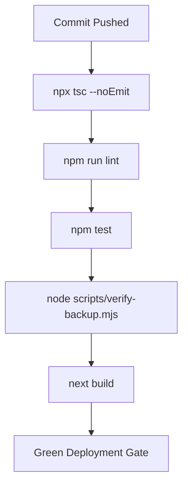

# AVSAR PLATFORM — ENTERPRISE RELEASE GOVERNANCE & CANARY DEPLOYMENT PROTOCOL

**System:** Avsar Recruitment Platform (AI Tathastu)  
**Standard:** Enterprise Production Release & SRE Operational Governance  
**Author:** Anant Kumar <anant9934@users.noreply.github.com>  
**Version:** 1.0.0 (Production Assurance)  

---

## 1. Principles of Release Governance

Avsar adheres to continuous integration, trunk-based development, and progressive delivery inspired by high-reliability consumer internet architectures:

1. **Trunk-Based Development:** All features merge into `main` in short-lived, verified branches. Long-lived drift branches are prohibited.
2. **Strict Atomic Commit Protocol:** Every code change receives an individual, meaningful commit with verified typechecking and test coverage.
3. **Decoupled Deployment from Release:** Code deployments are decoupled from user exposure via dynamic feature flags (`src/lib/flags/`). New capabilities are deployed dark and activated progressively.
4. **Automated Verification Gates:** No code is promoted to production without passing static analysis, integration tests, and schema integrity validation.

---

## 2. Pre-Merge Automated CI/CD Gates

Every commit and pull request must satisfy the following automated gates before merging to `main`:



1. **TypeScript Type Safety:** `npx tsc --noEmit` must return 0 errors.
2. **Linting & Code Standards:** `npm run lint` must return 0 errors and 0 warnings.
3. **Automated Regression Suite:** `npm test` must achieve 100% pass rate across all unit, integration, and security suites.
4. **Database DDL Integrity Audit:** `node scripts/verify-backup.mjs` must confirm all 8 enterprise tables and indexes exist.
5. **Production Build Validation:** `npm run build` must cleanly generate static assets and serverless lambdas.

---

## 3. Canary Deployment Progression Stages

To limit blast radius, major releases advance through four progressive exposure gates:

```
+------------+       +------------+       +------------+       +------------+
|  Stage 1   | ----> |  Stage 2   | ----> |  Stage 3   | ----> |  Stage 4   |
| Canary 10% |       | Canary 25% |       | Canary 50% |       |   100% GA  |
| (5 mins)   |       | (15 mins)  |       | (30 mins)  |       | (Complete) |
+------------+       +------------+       +------------+       +------------+
```

### Stage 1: Canary 10% (Internal & Early Cohort)
- **Exposure:** 10% of randomized incoming candidate traffic or explicit staff allowlist.
- **Duration:** 5 minutes.
- **Observation:** Real-time log monitoring for 5xx errors, unhandled promise rejections, or cold start latency spikes.

### Stage 2: Canary 25%
- **Exposure:** 25% of general candidate traffic via deterministic hash bucketing (`getDeterministicBucket`).
- **Duration:** 15 minutes.
- **Verification:** Monitor `/api/health/diagnostics` for database pool saturation (`waitingCount === 0`) and replica lag.

### Stage 3: Canary 50%
- **Exposure:** 50% of candidate traffic.
- **Duration:** 30 minutes.
- **Verification:** Evaluate application submission success rate, cache hit ratio (> 70%), and P95 latency (< 200ms).

### Stage 4: 100% General Availability (GA)
- **Exposure:** 100% of platform traffic.
- **Post-Release Checklist:** Run automated post-deployment smoke suite `scripts/canary-health-check.mjs`.

---

## 4. Automated Rollback Triggers & Thresholds

An automated or manual rollback is initiated immediately if any of the following SLI thresholds are breached during a canary release:

| SLI / Metric | Warning Threshold | Critical Rollback Trigger | Observation Window |
| :--- | :--- | :--- | :--- |
| **HTTP 5xx Error Rate** | > 0.1% | **> 0.5%** | Sustained for 2 minutes |
| **P95 Latency (/api/jobs)** | > 200ms | **> 400ms** | Sustained for 3 minutes |
| **P99 Latency (/api/applications)** | > 800ms | **> 1,500ms** | Sustained for 3 minutes |
| **Readiness Probe Failure** | `/api/health/ready` != 200 | **HTTP 503** | 2 consecutive probe failures (30s) |
| **Database Pool Saturation** | `waitingCount > 3` | **`waitingCount > 10`** | Sustained for 2 minutes |

---

## 5. Instant Rollback Execution Procedures

### Procedure A: Instant Binary Rollback (Vercel)
If the new code bundle causes runtime errors or dependency crashes:
```bash
# Instantly roll back production traffic to the previous deployment alias
vercel rollback
```
*Latency:* < 10 seconds (Anycast DNS and edge routing point back to previous immutable deployment artifact).

### Procedure B: Feature Flag Kill-Switch (Zero Code Deployment)
If the incident is isolated to a specific feature (e.g. matching score calculation v2):
```bash
# Disable the feature flag instantly without code deployment
vercel env add FEATURE_FLAG_ENHANCED_MATCH_SCORE_V2 false production
```
The runtime evaluates the new value on the next request, instantly dropping exposure to 0%.

### Procedure C: Database Migration Rollback
If a schema migration failed:
1. Enable `FEATURE_FLAG_MAINTENANCE_MODE=true`.
2. Inspect `schema_migrations` table.
3. Execute the corresponding down-migration script or restore from pre-migration PITR snapshot.

---

## 6. Post-Incident Review (PIR) & Release Sign-Off

Within 24 hours of any rollback or P1/P2 production incident:
1. The on-call SRE and release engineer must publish a formal PIR documenting:
   - Incident timeline (T+0 alert to T_recovery).
   - Root cause analysis (5 Whys).
   - Customer impact (number of candidates/recruiters affected, failed applications).
   - Preventative action items with assigned owners and Jira/Linear ticket links.
2. Code fixes must include an automated regression test reproducing the failure before re-attempting canary rollout.
